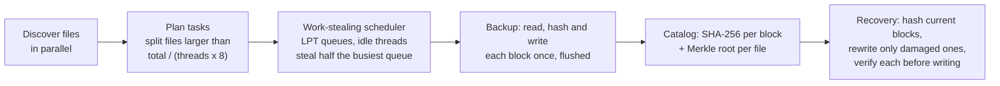

# IPBRS: parallel backup and block-level selective recovery

IPBRS is a C++17 / OpenMP engine that backs up a folder and later repairs it, using every core of a multi-core machine. It hashes each file as a **Merkle tree of 1 MiB blocks**, so a large file can be split into pieces that different threads hash, copy and repair, balanced by a **cost-aware work-stealing scheduler**. Recovery compares block hashes and **rewrites only the damaged blocks**.

Ordinary parallel backup gives each *file* to one thread, because SHA-256 must read a file from start to end. When a few files are much larger than the rest, most threads wait. IPBRS applies the parallelism *inside* files instead.


## Results

Measured on an AMD Ryzen 7 7435HS (8 cores, 16 threads), best of 3, every run independently verified. Details in [RESULTS.md](RESULTS.md).

| | File-level scheduling | IPBRS |
|---|---|---|
| Verify, a few huge files, 16 threads | 3.6× (stops improving at 4 threads) | **6.9×** |
| Damage detection, same workload | 3.6× | **7.4×** |
| Worker idle time at 16 threads | 72% | **2%** |
| Block recovery, 5% of files damaged | 1.89 s | **1.01 s**, rewriting 0.15% of the data (5.7× faster than full recovery) |
| Durable backup, 16 threads | 2–4×, limited by the SSD | best on huge files: 3.3× vs 2.8× |

When no file dominates the work (many small or mixed-size files), IPBRS performs the same as file-level scheduling: the split rule does not trigger, so it costs nothing. Full hashing found 100% of damaged files; a size-and-timestamp check found 75%, missing all silent corruption.

## How it works



- **Merkle block catalog:** leaf = SHA-256(0x00 ‖ block), node = SHA-256(0x01 ‖ left ‖ right).
- **Adaptive splitting:** no task exceeds total work ÷ (threads × 8), which bounds the finish time by Graham's list-scheduling bound.
- **Four scheduling policies** (`seq`, `static`, `dynamic`, `steal`) share one task model, so backup, verification and recovery are compared fairly.
- **Storage designed from measurements:** files over 16 MiB are stored as 16 MiB segment objects, because NTFS serialises threads writing one file; whole-file restores are not split for the same reason.
- **Safety:** durable writes, an atomically written and validated catalog, backups committed only if every file succeeds, and damaged backup blocks never written back.

## Quick start

Requirements: Windows with Visual Studio 2022 Build Tools (C++ workload); Python 3 with matplotlib for the benchmarks.

```powershell
build.bat test                                         # build and run the 38 tests
powershell -ExecutionPolicy Bypass -File demo.ps1      # one-minute live demo
```

```powershell
build\ipbrs.exe gen     --out data\src --files 2000 --big-files 2 --big-mib 512
build\ipbrs.exe backup  --source data\src --backup data\bk
build\ipbrs.exe damage  --target data\src --ratio 0.05
build\ipbrs.exe recover --source data\src --backup data\bk --dry-run    # report only
build\ipbrs.exe recover --source data\src --backup data\bk              # repair damaged blocks
build\ipbrs.exe verify  --backup data\bk --split none                   # compare with file-level
```

Every command prints a JSON record with timings and per-thread statistics. Options are listed by `build\ipbrs.exe help`.

## Reproducing the experiments

```powershell
python bench\workloads.py       # three workloads, about 3.2 GB
python bench\run_backup.py      # 279 runs
python bench\run_recovery.py    # 270 runs
python bench\run_scan.py        # 324 runs
python bench\plot.py            # figures in results\figures
```

Runners shuffle the run order, resume where they stopped, and store every raw record in `results/`.

## Documentation

- [RESULTS.md](RESULTS.md): the full experimental report.
- [Study guide](docs/study-guide/README.md): the project explained from first principles, how every part works, how the results were obtained, and interview questions.
- [DESIGN.md](DESIGN.md): a summary of the design decisions.

## Repository layout

```text
src/        engine: scheduler, planner, catalog, backup/recovery, hashing, file I/O, CLI
tests/      38 unit and end-to-end tests
bench/      benchmark runners and plotting (Python)
results/    raw records, summaries and figures
docs/       study guide
demo.ps1    live demo
legacy/     the first prototype
```

## Credits

IPBRS began as a team project for a parallel computing course. **Sadhana Mohanraj** wrote the first prototype (C++/OpenMP backup and recovery with Python tooling), kept in [`legacy/`](legacy/). **Harshith R** audited it and led the rebuild around block-level scheduling and selective recovery, including the tests, benchmarks, experiments, analysis, demo and documentation. The commit history records the work.
