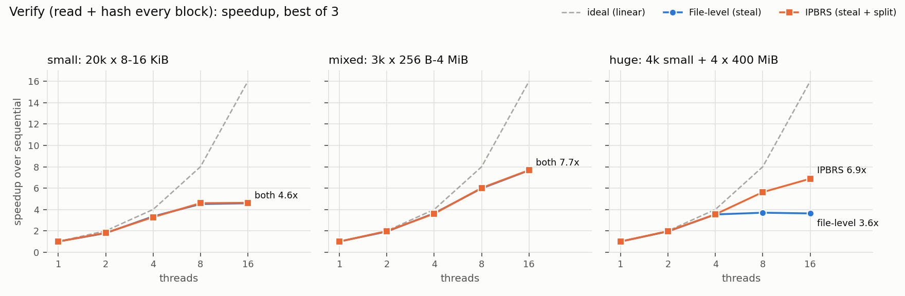
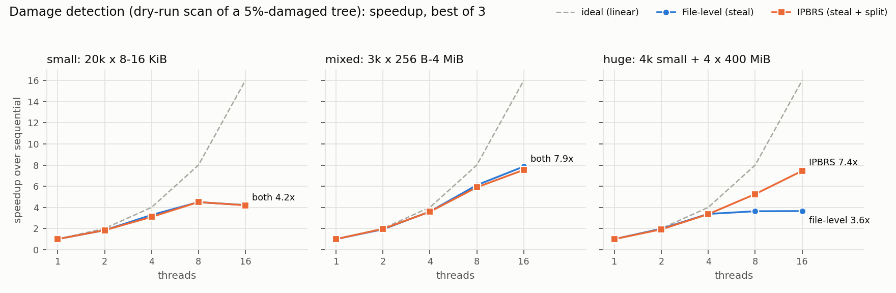
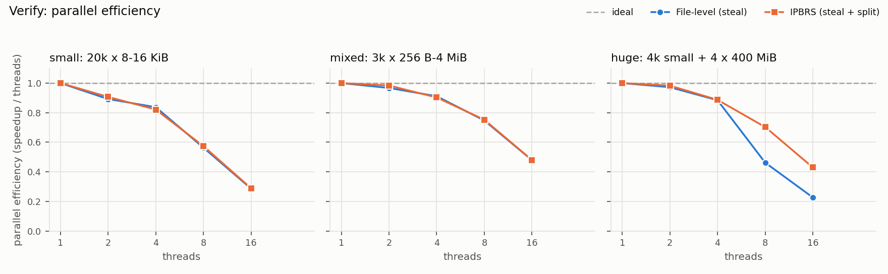
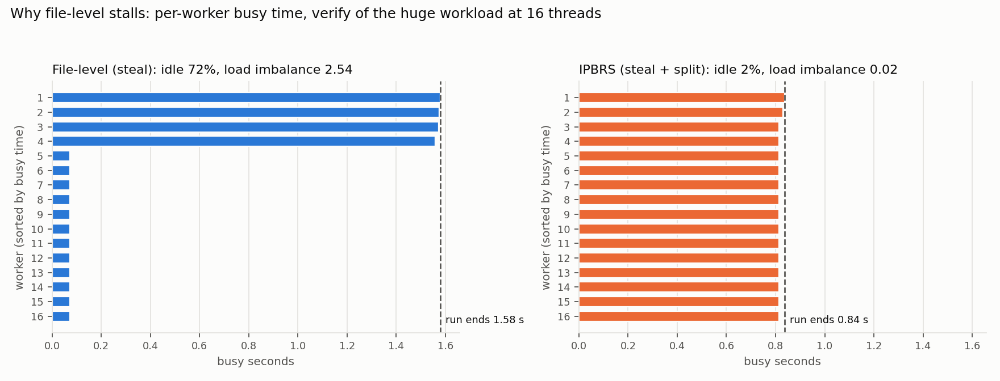
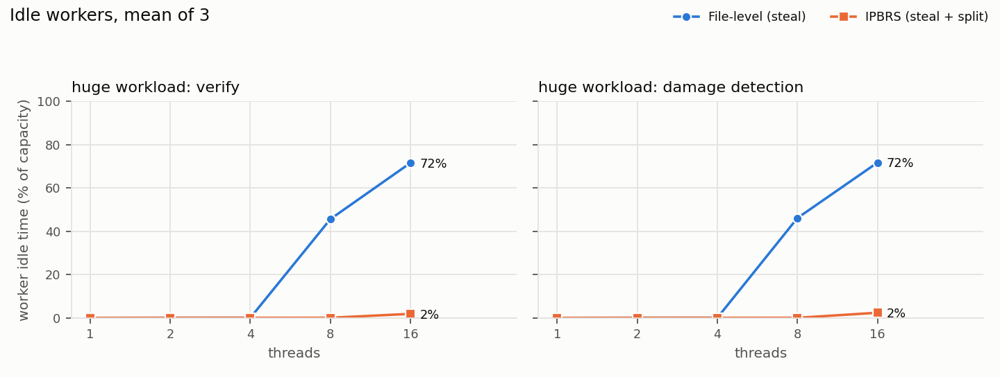
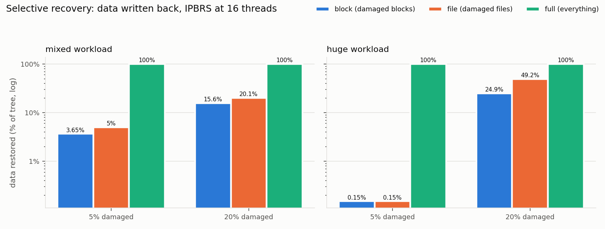
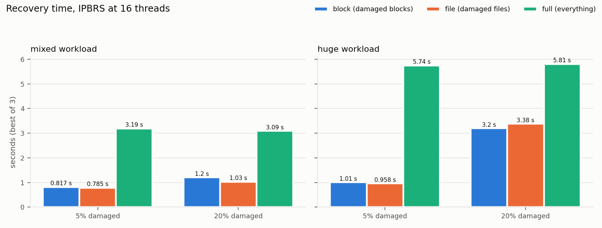
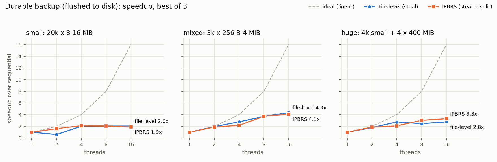

# IPBRS: experimental results

This report covers 873 measured runs of the IPBRS engine: backup, selective recovery, backup verification and damage detection, at 1 to 16 threads. Every run passed its correctness check. The raw records are in [`results/`](results/) and every figure can be regenerated with `python bench/plot.py`.

## Summary

- **Parallel execution works.** Verifying a backup (reading and hashing every block) runs **4.6–7.7× faster at 16 threads** than sequentially. Durable backup, where every file is flushed to disk, runs **2–4× faster**; the SSD's write speed limits it.
- **File-level scheduling has a hard limit when a few files dominate.** On the `huge` workload, every file-level policy (static, dynamic, work stealing) stops improving at 4 threads, at about 3.6×. At 16 threads, **72% of worker time is idle** while a few workers hash the four 400 MiB files.
- **Splitting large files into block tasks removes that limit.** With IPBRS, verification keeps scaling to **6.9×** and damage detection to **7.4×**, about **2× faster than file-level** at 16 threads, with idle time down from 72% to 2%.
- **Selective recovery avoids most of the work.** With 5% of files damaged in `huge`, it writes back **0.15% of the data** and is **5.7× faster than full recovery**; the gain shrinks to 1.8× at 20% damage, when more large files must be rewritten. At 20% damage, block-level recovery writes **half the data** that file-level recovery does (25% vs 49% of the tree).
- **Where IPBRS does not help:** when no single file dominates (`small`, `mixed`), IPBRS and file-level scheduling perform the same, and splitting adds no measurable overhead. Write-bound backup is limited by the drive whatever the scheduling.

## 1. Setup

| | |
|---|---|
| CPU | AMD Ryzen 7 7435HS, 8 cores / 16 threads |
| Memory | 16 GB |
| Storage | WD PC SN740 512 GB NVMe SSD, NTFS, about 90% full during the runs |
| Software | Windows 11, MSVC 19.44 (VS 2022 Build Tools), OpenMP 2.0, Release build (`/O2`) |
| Engine | 1 MiB blocks, 16 blocks per backup segment, split factor 8, per-task cost 64 KiB |

### Workloads

Generated with a fixed seed by `bench/workloads.py`. 5% of files are duplicates of earlier files.

| Workload | Files | Size | What it represents |
|---|---|---|---|
| `small` | 20,000 × 8–16 KiB | 234 MiB | Many tiny files: per-file overhead dominates |
| `mixed` | 3,000, log-uniform 256 B – 4 MiB | 1,300 MiB | Heterogeneous sizes, no single file dominates |
| `huge` | 4,000 small + 4 × 400 MiB | 1,647 MiB | A few files hold most of the bytes |

### Configurations compared

- **Sequential:** one worker, the speedup baseline.
- **Static:** cost-aware longest-processing-time (LPT) partition, no runtime balancing.
- **Dynamic:** conventional self-scheduling from a shared counter.
- **Steal (file-level):** LPT partition seeds per-worker queues, and idle workers steal half of the busiest worker's remaining cost.
- **IPBRS (steal + split):** as steal, but any file larger than total cost ÷ (threads × 8) is split into block-range tasks. No task then exceeds that size, so by Graham's list-scheduling bound the run cannot finish later than total ÷ threads plus one piece.

### Method

- Runs execute in a seeded random order, so slow drift such as heat or caching does not favour one configuration. Each configuration has three repetitions, with a 2 s pause between runs and an untimed warm-up pass per workload.
- **Correctness is checked separately from timing.** After a backup, an independent `verify` re-hashes the stored copy. Every recovery re-hashes the files it repaired. Every detection scan is compared with the known damage.
- **Timings are best of three.** Write-heavy runs on this machine are bimodal: identical single-thread backups take either about 40 s or 140–170 s (`small`). That is the nearly full SSD falling into a slow write mode, not the engine, so the best repetition is the fairer measure of the system. Read-only runs have small spread (typically ±0.01–0.1 s), and their mean and best agree.

## 2. Verify and damage detection (read and hash)

These operations only read and hash, so they isolate the CPU-bound work that block splitting targets. They are also the cleanest measurements.



**Verify, `huge` workload (best of 3, seconds):**

| Threads | File-level steal | IPBRS | IPBRS speedup over sequential |
|---|---|---|---|
| 1 (sequential) | 5.98 | 5.98 | 1.0× |
| 2 | 3.07 | 3.04 | 2.0× |
| 4 | 1.69 | 1.68 | 3.6× |
| 8 | 1.62 | 1.06 | 5.6× |
| 16 | 1.65 | **0.87** | **6.9×** |

Static and dynamic scheduling stall in the same place (1.62–1.70 s at 8 and 16 threads), so the limit comes from file-level granularity, not from any one policy. On `small` and `mixed`, every policy with or without splitting reaches the same speedup at 16 threads: 4.6× (2.78 → 0.60 s) and 7.7× (4.94 → 0.64 s).



**Damage detection** (a dry-run scan of a tree with 5% of files damaged) behaves the same way. On `huge` at 16 threads, IPBRS takes **0.78 s against 1.59 s** for file-level, 7.4× against 3.6× over sequential (5.81 s).



## 3. Why file-level stalls: load balance



In one 16-thread verify of `huge`, file-level stealing gives the four 400 MiB files to four workers. Those four are busy for 1.58 s; the other twelve finish their small files in under 0.1 s and then have nothing left to steal, because a task in progress cannot be divided. **Load imbalance is 2.54 and 72% of worker time is idle.** With splitting, each large file becomes many 16 MiB pieces that any worker can take. All sixteen workers are busy for 0.82–0.84 s and the run ends at 0.84 s, with imbalance 0.02 and 2% idle.



Up to 4 threads the four large files keep every worker busy, so both approaches are equal. From 8 threads on, file-level idle time climbs to 46% and then 72%, while IPBRS stays near zero.

## 4. Selective recovery

Each run damages the same seeded set of files (all four damage types: missing, modified, silently corrupted, truncated) and then repairs them from the backup.

- **Block mode** restores only damaged blocks of files that kept their size.
- **File mode** restores whole damaged files.
- **Full** restores everything without inspecting the tree.

**16 threads, best of 3:**

| Workload, damage | Mode | IPBRS (s) | File-level (s) | Data written back |
|---|---|---|---|---|
| `huge`, 5% | block | **1.01** | 1.89 | 2.4 MiB (0.15%) |
| | file | 0.96 | 1.87 | 2.4 MiB (0.15%) |
| | full | 5.74 | 5.96 | 1,647 MiB (100%) |
| `huge`, 20% | block | **3.20** | 4.36 | **410 MiB (25%)** |
| | file | 3.38 | 4.20 | 810 MiB (49%) |
| | full | 5.81 | 6.22 | 1,647 MiB (100%) |
| `mixed`, 5% | block | 0.82 | 0.90 | 47 MiB (3.6%) |
| | file | 0.78 | 0.72 | 65 MiB (5.0%) |
| | full | 3.19 | 3.52 | 1,300 MiB (100%) |
| `mixed`, 20% | block | 1.20 | 1.16 | 203 MiB (16%) |
| | file | 1.03 | 1.21 | 261 MiB (20%) |
| | full | 3.09 | 2.83 | 1,300 MiB (100%) |

All cells, including 4-thread and `small` results, are in `results/recovery_summary.csv`.





**Observations:**

- Selective recovery is **1.8–5.7× faster than full recovery** at the same thread count. The gain is largest at low damage (5.7× on `huge` at 5%) and shrinks as more data must be rewritten (1.8× on `huge` at 20%). On `huge` at 5%, IPBRS block recovery is also **6.2× faster than sequential block recovery** (6.23 s → 1.01 s).
- Most of the time goes into scanning the tree, and scanning is where splitting helps. That is why IPBRS beats file-level by 1.9× on `huge` at 5% damage. On `mixed`, where no file dominates, the two are within noise of each other.
- Block and file mode take about the same time because both are dominated by the scan. Block mode's benefit is in **writes**: at 20% damage on `huge` it writes half as much data. That matters for SSD wear and for slower or remote storage.
- At 20% damage on `huge`, some large files are deleted or truncated and have to be rewritten whole. Whole-file restores are deliberately not split, because pieces writing one NTFS file serialise (section 6). Those restores keep restore-phase imbalance high, at about 4.8.

## 5. Durable backup



**Speedup at 16 threads over the best sequential run:**

| Workload | Sequential best | File-level steal | IPBRS | Best policy |
|---|---|---|---|---|
| `small` | 40.1 s | 2.0× | 1.9× | 2.2× (static + split) |
| `mixed` | 13.5 s | 4.3× | 4.1× | 4.3× |
| `huge` | 17.7 s | 2.8× | **3.3×** | **3.3× (IPBRS)** |

Backup reads, hashes, writes and flushes every byte, and it is limited by the SSD. Parallel threads still help, by overlapping the per-file flush latency of `small` and by keeping the drive's queue full. IPBRS is best on `huge`, where it also cuts load imbalance from 0.76 to 0.06 (mean of 3). On `small` and `mixed` all policies are within noise of each other.

## 6. Design decisions driven by measurement

1. **Large files are stored as segment objects.** Writing many pieces of one large backup file concurrently was slower than writing it with one thread, because NTFS serialises writers that extend a file. Files larger than 16 blocks are therefore stored as separate 16 MiB segment files, and split pieces align with segment boundaries, so concurrent writers never share a file.
2. **Whole-file restores are not split.** The same NTFS effect made full recovery with splitting take 14.9 s against 9.8 s without. Ranges that would all write one target file are now planned as single tasks; scans and in-place block repairs still split. Afterwards both variants took 6.0 s.
3. **Durable writes.** Backup and recovery flush every written object, and the catalog, before reporting success, so a completed backup survives power loss. `--no-sync` exists only for comparison.

## 7. Correctness

- All 279 backups verified clean. All 270 recoveries repaired their damage and passed the post-recovery check. All 324 verify and detection runs were clean, and every full-hash scan found every damaged file.
- **Full hashing against the `--trust-mtime` shortcut.** Skipping files whose size and modification time match makes detection 2–39× faster, depending on workload and thread count (`huge`, 16 threads: 0.07 s against 0.78 s), but it found only **75%** of the damage. It missed every silently corrupted file, the case where a byte changes but the timestamp does not, as with bit rot. IPBRS therefore hashes by default.
- 38 unit and end-to-end tests cover SHA-256 against NIST vectors, the Merkle tree, catalog tampering, exactly-once execution of every scheduler policy at 1–16 threads, and byte-for-byte recovery of all damage types (`build.bat test`).

## 8. Limitations

- **Storage noise.** Write-heavy timings vary because the SSD was about 90% full and Windows Defender scanned new files. Best-of-3 reduces this but does not remove it; a few backup cells, such as file-level steal on `small` at 2 threads, are still affected.
- **Warm cache.** Source data was usually in the OS page cache, so read-side results show CPU and scheduling behaviour more than raw disk reads.
- **One machine, three repetitions.** The results show the behaviour on one consumer laptop. Other storage, such as a RAID array, a network drive or a faster SSD, would change where the write limit sits.
- **Portable SHA-256.** The engine uses its own SHA-256 implementation. A hardware-accelerated one (SHA-NI) would make hashing cheaper, so the workload would shift further toward I/O.

## 9. Reproducing

```powershell
build.bat test                       # build (MSVC + OpenMP) and run the tests
python bench\workloads.py            # generate the three workloads (~3.2 GB)
python bench\run_backup.py           # ~2 h 10 min on the test machine
python bench\run_recovery.py         # ~1 h 10 min
python bench\run_scan.py             # ~10 min
python bench\plot.py                 # figures into results\figures
```

Every runner resumes where it stopped and appends to its `results/*.jsonl` file. Each record holds the configuration, the engine's full JSON result (including per-worker statistics) and the machine description.
