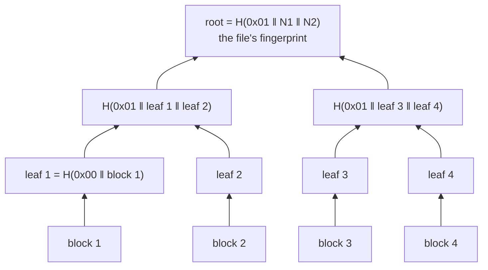
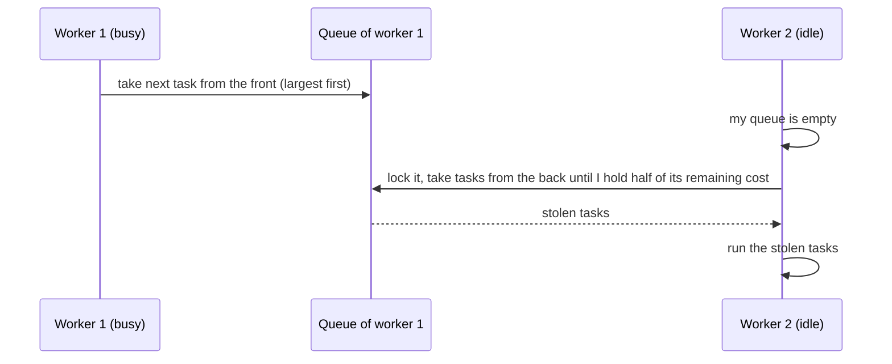

# 1. Foundations

This chapter explains every idea the project is built on, from zero. If you can explain each section in your own words, you understand the theory behind IPBRS.

[Back to the guide](README.md) · Next: [2. The project story](2-the-project.md)

---

## 1.1 Backup and recovery

A **backup** is a copy of your files kept somewhere else, so you can get them back if the originals are lost or damaged. **Recovery** (or restore) copies files from the backup back to where they belong.

There are three kinds of damage a backup protects against, and IPBRS tests all of them (plus a fourth, silent one):

| Damage | What happened | Example |
|---|---|---|
| **Missing** | The file is gone | Accidental delete |
| **Modified** | The contents changed (and the modification time changed) | A program overwrote part of it |
| **Truncated** | The file got shorter | A crash while writing |
| **Silently corrupted** | One byte changed, but the size and the modification time did *not* | Bit rot on a disk, a bad cable, a buggy driver |

Two ways to recover:

- **Full recovery** restores *every* file, whether it is damaged or not. Simple, but slow: if 1 file out of 4,000 is broken, it still rewrites all 4,000.
- **Selective recovery** first works out *which* files (or, in IPBRS, which *blocks* of which files) are damaged, and rewrites only those.

Selective recovery needs a reliable way to tell "this file is still exactly what we backed up". That is what hashing is for.

## 1.2 Files, blocks, the disk and the page cache

A file is a sequence of bytes. IPBRS cuts every file into **blocks** of 1 MiB (1,048,576 bytes). A 400 MiB file has 400 blocks; a 10 KiB file has 1 block (the last block of a file is usually shorter). An empty file is treated as one empty block.

When a program writes a file, the operating system usually does **not** write to the disk immediately. It copies the data into the **page cache** (memory) and writes it to the disk later. That is why "copying" can look very fast, and also why a power cut can lose data that a program thought it had saved.

A backup must survive a power cut, so after writing, IPBRS calls **`FlushFileBuffers`** (Windows; `fsync` on Linux), which waits until the data is really on the disk. This is called a **durable** write. It is slower, and it is the honest way to time a backup. (`--no-sync` turns it off, for comparison only.)

**CPU-bound vs I/O-bound.** A task is *CPU-bound* when the processor is the bottleneck (here: computing SHA-256), and *I/O-bound* when the disk is (here: writing and flushing backups). More threads help CPU-bound work a lot; they help I/O-bound work only until the disk is saturated. This explains most of our results.

## 1.3 Hashing and SHA-256

A **cryptographic hash function** turns any amount of data into a short fixed-size "fingerprint". SHA-256 produces 256 bits (32 bytes, written as 64 hex characters).

```text
SHA-256("abc") = ba7816bf8f01cfea414140de5dae2223b00361a396177a9cb410ff61f20015ad
```

Properties that matter here:

1. **Deterministic:** the same input always gives the same hash.
2. **Avalanche:** changing a single bit of the input changes about half the output bits, so even a one-byte corruption gives a completely different hash.
3. **Collision resistance:** it is practically impossible to find two different inputs with the same hash. So "same hash" means "same data".

So to check a file, we compare its hash today with the hash stored at backup time. If they match, the file is intact.

**Why SHA-256 cannot be parallelised inside one file.** SHA-256 processes the data in 64-byte chunks, and each step needs the result of the step before it (this is called the Merkle–Damgård construction):


Chunk 3 cannot start before chunk 2 is finished. So one file is hashed by **one** thread, start to finish. On the test laptop one thread verifies about 275 MiB/s (measured: 1,647 MiB in 5.98 s), so a 400 MiB file takes about 1.5 s no matter how many cores you have. **This is the root of the problem IPBRS solves.**

IPBRS uses its own portable SHA-256 implementation (`src/sha256.cpp`), tested against the official NIST test vectors.

## 1.4 Merkle trees: hashing that can be parallelised

A **Merkle tree** hashes each block separately, then hashes pairs of hashes, up to a single **root**:



Why this helps:

1. **Parallel:** the leaf hashes are independent. Block 1 and block 400 can be hashed at the same time by different threads. The tree on top is tiny and cheap.
2. **Localisation:** if one block is damaged, only its leaf changes. Comparing leaves tells you *exactly which block* is broken, so recovery can rewrite just that block.
3. **Still one fingerprint:** the root changes if any block changes, so it identifies the whole file like a normal hash.

**Details used in IPBRS** (`src/merkle.cpp`):

- leaf = SHA-256(`0x00` + block bytes); inner node = SHA-256(`0x01` + left + right).
- The `0x00` / `0x01` prefixes are **domain separation**: a leaf can never be confused with an inner node. Without them, an attacker could present an inner node's input as if it were a block (a "second-preimage" trick).
- With an odd number of nodes, the last one is promoted to the next level unchanged.
- The catalog stores every leaf and the root. When loading, IPBRS recomputes the root from the leaves and rejects the catalog if they disagree.

Merkle trees are not new: Git, Bitcoin, ZFS, IPFS and the BLAKE3 hash all use them. What is specific to IPBRS is using them so that the **scheduler** can split big files and recovery can work **per block**.

## 1.5 Threads, cores and parallelism

- A **process** is a running program. A **thread** is one sequence of instructions inside a process; all threads of a process share its memory.
- A **core** runs one thread at a time. The test laptop has **8 cores**. Each core supports 2 hardware threads (simultaneous multithreading, "SMT"), so Windows sees **16 logical processors**. Two threads on one core share it, so 16 threads give less than 16× (and less than 2× over 8 threads).
- **Parallelism** means doing parts of a job at the same time on several cores.

### Speedup, efficiency and Amdahl's law

- **Speedup** S(P) = time with 1 thread ÷ time with P threads. S(16) = 6.9 means 6.9 times faster.
- **Parallel efficiency** E(P) = S(P) ÷ P. E = 1.0 is perfect; 6.9 ÷ 16 = 0.43.
- **Amdahl's law:** if a fraction *s* of a job cannot be parallelised, the speedup can never exceed 1 ÷ *s*, however many threads you add.

```text
S(P) = 1 / ( s + (1 - s) / P )
Example: s = 10% serial  ->  S(16) = 1 / (0.1 + 0.9/16) = 6.4,  and never more than 10
```

The "huge" workload is an Amdahl story in disguise: if one 400 MiB file can only be hashed by one thread, that file is a serial part that caps the speedup. IPBRS removes it by splitting the file.

### Load imbalance and idle time

When the work is shared unevenly, some threads finish early and wait. IPBRS measures:

- **Load imbalance** LI = (busiest thread's busy time − average busy time) ÷ average. 0 is perfect. LI = 2.54 means the busiest thread worked 3.54× the average.
- **Idle fraction** = 1 − (total busy time of all threads) ÷ (threads × wall-clock time). 72% idle means almost three quarters of the machine's capacity did nothing.

## 1.6 OpenMP

**OpenMP** is a standard way to write multi-threaded C/C++ using compiler directives (`#pragma omp ...`). The compiler and its runtime create and manage the threads. MSVC supports OpenMP 2.0 with the `/openmp` flag.

The two forms IPBRS uses (simplified from `src/scheduler.cpp` and `src/scheduler.hpp`):

```cpp
// 1. A parallel region: every thread runs the block; each knows its number.
#pragma omp parallel num_threads(16)
{
    int worker = omp_get_thread_num();   // 0..15
    run_worker_loop(worker);             // our own scheduling logic
}

// 2. A parallel loop: OpenMP hands out iterations itself (used for simple phases
//    like checking file sizes); schedule(dynamic, 16) gives 16 iterations at a time.
#pragma omp parallel for schedule(dynamic, 16) num_threads(16)
for (std::int64_t i = 0; i < n; ++i) body(i, omp_get_thread_num());
```

For the main work IPBRS uses form 1 and its **own** scheduler (static, dynamic or work stealing), because OpenMP 2.0's built-in schedules know nothing about task costs and cannot steal. Exceptions must never escape a parallel region (the program would terminate), so every task runs inside `try`/`catch`, and a failure is recorded as a failed task.

## 1.7 Synchronisation

When threads share data, they must not interfere:

- **Race condition:** two threads read and write the same data at the same time and the result depends on timing. Example: two threads both doing `count = count + 1` can lose an update.
- **Mutex** (`std::mutex`): a lock; only one thread at a time can hold it. IPBRS protects each worker's task queue with one.
- **Atomic variable** (`std::atomic`): a variable whose operations are indivisible. `fetch_add(n)` adds and returns the old value in one step, so no two threads ever get the same value. The dynamic scheduler uses it as a shared "next task" counter.
- **Exactly once:** every task must run once and only once: never skipped, never duplicated. The test `scheduler_runs_every_task_exactly_once` checks this for every policy at 1, 2, 3, 8 and 16 threads.

IPBRS avoids sharing where it can: each worker has its own statistics slot and its own 1 MiB buffer, and different tasks always write different blocks, so the hot path needs no locks.

## 1.8 Scheduling: who does which task?

Suppose 7 tasks with costs 8, 7, 6, 5, 4, 3, 2 (total 35) and 2 workers. The ideal finish time is 35 ÷ 2 = 17.5.

**Static, in order** (first half to worker A, second half to worker B) can be very uneven. **Dynamic self-scheduling** lets each worker take the next task from a shared counter when it is free; this adapts at runtime, but it does not know costs, so a big task taken last finishes late.

**LPT (Longest Processing Time first):** sort tasks by cost, largest first, and always give the next task to the least-loaded worker.

```text
LPT:  A gets 8, then 5 (A=13), then 4 (A=17)          -> A = 8+5+4   = 17
      B gets 7, 6 (B=13), then 3 (B=16), then 2 (B=18) -> B = 7+6+3+2 = 18
      finish time 18, ideal 17.5
```

LPT is a classic approximation: it is never worse than 4/3 of the optimum. But it relies on **estimated** costs. If the estimates are wrong (a file is on a slower part of the disk, a thread shares its core), the plan is off.

**Work stealing** fixes wrong estimates at runtime. Each worker has its own queue. When a worker's queue is empty, it **steals** work from another worker's queue. This is how Cilk, Java's ForkJoinPool and Intel TBB balance load.



**IPBRS's work stealing** (`src/scheduler.cpp`, policy `steal`): LPT fills the queues at the start. A worker takes from the **front** of its own queue (largest tasks first). An idle worker picks the victim with the **most remaining estimated cost**, then takes tasks from the **back** of that queue (the cheap end) until it holds at least half of the victim's remaining cost. Taking half means one steal moves a lot of work, so steals are rare.

### Granularity: the key idea of IPBRS

**Granularity** is how big each task is. A task can never be split while it runs, so:

- **Too coarse** (one task per 400 MiB file): the run cannot end before the biggest task ends. With 4 huge files and 16 threads, 12 threads have nothing to do.
- **Too fine** (one task per 4 KiB): scheduling overhead (locks, opening files) dominates.

**Graham's list-scheduling bound** makes this precise. For any greedy scheduler (no worker idles while work is waiting) with P workers, total work W and largest task t_max:

```text
finish time  ≤  W / P  +  t_max
```

W / P is the ideal; t_max is the penalty. IPBRS's **adaptive split rule** limits t_max: any file larger than

```text
threshold = total estimated cost / (threads × 8)
```

is cut into pieces of about that size (rounded to whole blocks, and in backup to whole 16-block segments). So no task is bigger than 1/8 of a thread's fair share, and the penalty is at most 1/8 of the ideal finish time. The threshold adapts by itself:

- More threads → smaller pieces.
- A workload of small files → no file exceeds the threshold → **nothing is split**, so there is no overhead.
- One thread → no splitting at all.

The 8 is the **split factor** (`--split-factor`), a tunable trade-off between balance and overhead.

## 1.9 Glossary

| Term | Meaning |
|---|---|
| Block | A 1 MiB piece of a file; the unit of hashing and recovery |
| Leaf hash | SHA-256 of one block (with prefix 0x00) |
| Merkle root | The hash at the top of a file's tree; the file's fingerprint |
| Catalog | The backup's index: every file's size, time, leaf hashes and root (`catalog.ipbrs`) |
| Segment | A 16-block (16 MiB) piece of a big file, stored as its own file in the backup |
| Task | One unit of scheduled work: a run of blocks of one file |
| Cost | Estimated work of a task: 64 KiB fixed overhead + its bytes |
| LPT | Longest Processing Time first: assign largest tasks first to the least-loaded worker |
| Work stealing | Idle workers take queued tasks from busy workers' queues |
| Split threshold | Files bigger than total cost ÷ (threads × 8) are cut into pieces |
| Speedup | 1-thread time ÷ P-thread time |
| Efficiency | Speedup ÷ threads |
| Load imbalance | (max busy − mean busy) ÷ mean busy |
| Idle fraction | Share of total thread time spent not working |
| Durable write | Data flushed to the disk (`FlushFileBuffers`) before success is reported |
| Dry run | Recovery that only reports damage and changes nothing |
| `--trust-mtime` | Shortcut: skip hashing files whose size and modification time match; misses silent corruption |
| Best of 3 | Reporting the fastest of three repetitions to remove outside interference |
