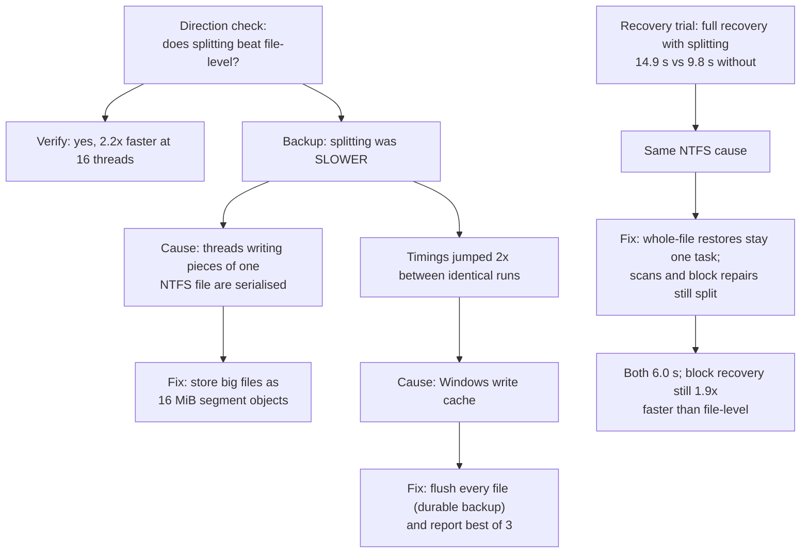

# 2. The project story

How the project started, what was wrong with the first version, what was built instead, and why. This is the story to tell when someone asks "walk me through your project".

[Back to the guide](README.md) · Previous: [1. Foundations](1-foundations.md) · Next: [3. How IPBRS works](3-how-it-works.md)

---

## 2.1 The brief

IPBRS started as a team project for a parallel computing course. For full marks, the instructor asked for one of two things:

1. solve a problem in parallel computing that is not already solved, or
2. apply parallelism somewhere it is not normally used,

and in both cases **show measured performance improvements**.

The project idea was already fixed: a parallel backup and selective recovery system on one multi-core machine, with an "intelligent" scheduler.

## 2.2 What existed: the first version

The first version (still on the `main` branch, and kept in `legacy/` on `harshith-dev`) was a C++/OpenMP prototype with Python tooling: a sequential reference implementation, five scheduling policies, backup, recovery, and a very large planned experiment matrix (21,624 runs, about 83 TB of estimated data).

A read-only audit found six problems:

| # | Problem | Why it mattered |
|---|---|---|
| 1 | The "adaptive granularity" policy computed the cost spread (coefficient of variation) but **never used it** | The documented adaptive rule did not exist in the code |
| 2 | "Granularity" only meant how many *files* a worker took at once; **nothing ever split a file** | Every policy was limited by its biggest file, the exact case where parallelism should help |
| 3 | Selective recovery **hashed every file on one thread** before restoring in parallel | The expensive part was serial, so Amdahl's law capped recovery speedup |
| 4 | Backup **read each file four times** (hash the source, copy, hash the temporary copy, hash the final copy) | Most of the I/O was redundant |
| 5 | The build script had **no optimisation flag** (`/O2`) | Every recorded timing came from an unoptimised build |
| 6 | The large-scale results were in a git-ignored folder on another machine; the repository held only 12–20-file pilots | No results could be checked or reproduced |

It was also hard to call it novel: parallel file copying with work stealing is what tools like `robocopy /MT` already do.

## 2.3 The decision: rewrite around one idea

We kept the project's goal and name, and rebuilt the engine around one idea that fixes problems 1–4 and gives a defensible novelty:

> **Schedule blocks, not files.** Hash each file as a Merkle tree of 1 MiB blocks, so that a large file can be split into pieces that different threads hash, copy and repair, and so that recovery can rewrite only the damaged blocks.

The old code was moved into `legacy/` (nothing was deleted from history).

### What is new, and what is not

Be precise about this in interviews and in the viva.

| Not new (well-known techniques) | What IPBRS contributes |
|---|---|
| Parallel file copying (`robocopy /MT`, rsync wrappers) | Splitting *inside* large files during backup, verification, damage detection and recovery |
| Merkle / tree hashing (Git, ZFS, BLAKE3, IPFS) | Using per-block hashes so the **scheduler** can split big files, and recovery can work **per block** |
| Work stealing (Cilk, TBB, Java ForkJoin) | Cost-aware work stealing over *mixed* file and block tasks, with a split rule tied to Graham's bound that switches itself off when no file dominates |
| Selective restore of changed files (rsync) | Block-level selective recovery that verifies every backup block before writing it |

The honest one-line claim: **IPBRS applies parallelism *inside* files, where file-level backup tools cannot, and measures where that helps and where it does not.**

## 2.4 How the design evolved: driven by measurement

Several design decisions came from measurements, including two that surprised us. These are good answers to "tell me about a problem you solved".



Two honest lessons from the process:

1. **A measurement mistake we caught.** For a while, rebuilds run from one shell were silently failing, so three backup experiments measured the *old* binary. The giveaway was that the catalog lacked a field the new code always writes. All those numbers were thrown away and rerun, and builds were then always checked for the "Built" line. The lesson: before trusting a benchmark, check that you are measuring the code you think you are.
2. **A reporting bug.** For dry-run recoveries, the summary first read load-balance statistics from the (empty) restore phase instead of the scan phase, so it showed no imbalance. It now uses whichever phase dominated the run.

## 2.5 The tech stack

| Layer | Choice | Why |
|---|---|---|
| Engine language | **C++17** | Direct control of threads, memory and file I/O; `std::filesystem` for portable path handling |
| Parallelism | **OpenMP 2.0** (`/openmp`) | The course's shared-memory model; thread creation and parallel regions without boilerplate. Scheduling logic is our own code on top |
| Compiler | **MSVC 19.44** (Visual Studio 2022 Build Tools), Release `/O2` | Native Windows toolchain with OpenMP |
| Build | **CMake + Ninja**, wrapped by `build.bat` | Standard, reproducible builds; `build.bat test` also runs the tests |
| File I/O | Windows API: `CreateFileW`, `ReadFile`/`WriteFile` with offsets, `FlushFileBuffers`, `GetFileAttributesExW` | Positioned reads and writes let several threads work on different parts of a file; one metadata call per file |
| Hashing | Our own portable SHA-256 + Merkle tree | No dependencies; tested against NIST vectors |
| Tests | Small self-written test harness + CTest | No external libraries to install |
| Benchmarks | **Python 3** (standard library) | Run matrices, shuffle order, resume, summarise to CSV |
| Charts | **matplotlib** | Reproducible figures from the result files |
| Demo | **PowerShell** script | Runs on any Windows machine; uses Windows' own `Get-FileHash` as an independent check |

## 2.6 Repository layout

```text
src/                     the engine (C++)
  util.*                 timer, deterministic random numbers, JSON writer
  sha256.* merkle.*      hashing
  fileio.*               positioned file reads/writes, metadata, flush
  scheduler.*            the four scheduling policies + statistics
  workload.*             parallel file discovery + the task planner (split rule)
  catalog.*              the backup index: format, safety checks, file layout
  engine.*               backup, verify and recovery
  dataset.*              synthetic dataset generator + damage injector
  main.cpp               command-line interface
tests/                   38 tests (unit + end-to-end)
bench/                   workloads.py, run_backup.py, run_recovery.py, run_scan.py, plot.py
results/                 raw results (*.jsonl), summaries (*.csv), logs, figures/
docs/study-guide/        this guide
demo.ps1                 the live demo
RESULTS.md               the results report
build.bat CMakeLists.txt build
legacy/                  the first version, kept for reference
```

## 2.7 The commit history

The work on `harshith-dev` is 24+ focused commits, each building and passing the tests:

| Phase | Commits | What happened |
|---|---|---|
| Engine | 2 | Rewrite around Merkle blocks and the hybrid scheduler; segment storage and durable writes |
| Tests | 5 | Test harness; SHA-256 (NIST); Merkle and catalog; scheduler exactly-once; end-to-end recovery |
| Fixes found by testing | 4 | Absolute alignment of split pieces; catalog hardening; richer statistics; whole-file restores unsplit |
| Benchmark tools | 5 | Workloads; backup, recovery and scan runners; `--dry-run` |
| Experiments | 3 | 279 backup, 270 recovery and 324 verify/detection runs, all verified |
| Analysis | 3 | Speedup/efficiency charts; load-balance and recovery charts; RESULTS.md |
| Demo and guide | 2+ | `demo.ps1`; this study guide |
