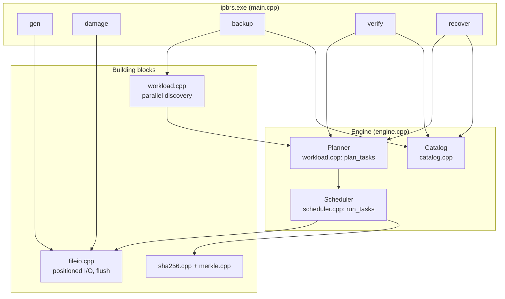
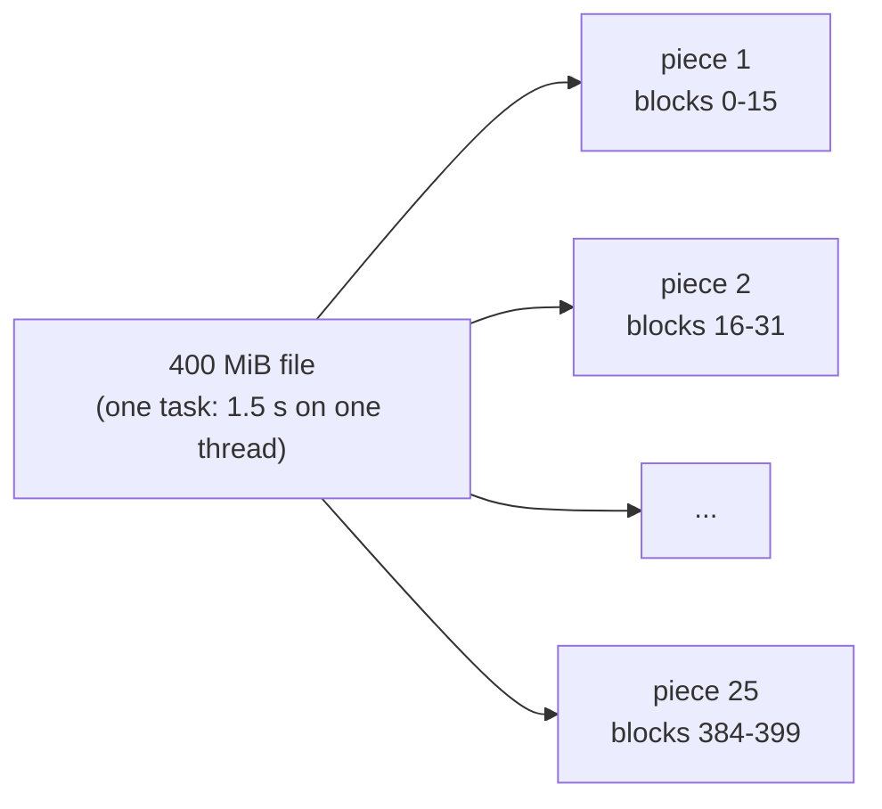
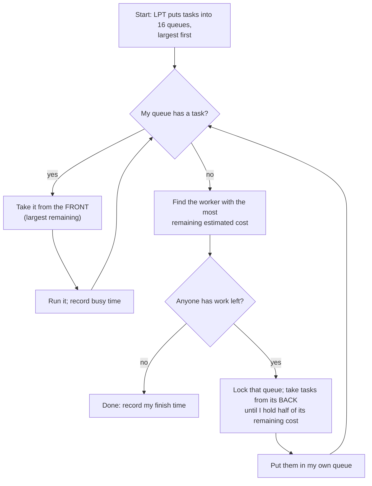
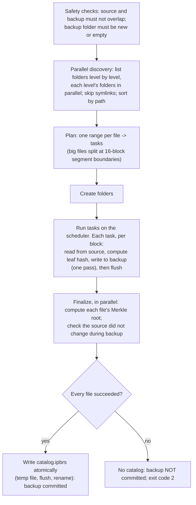
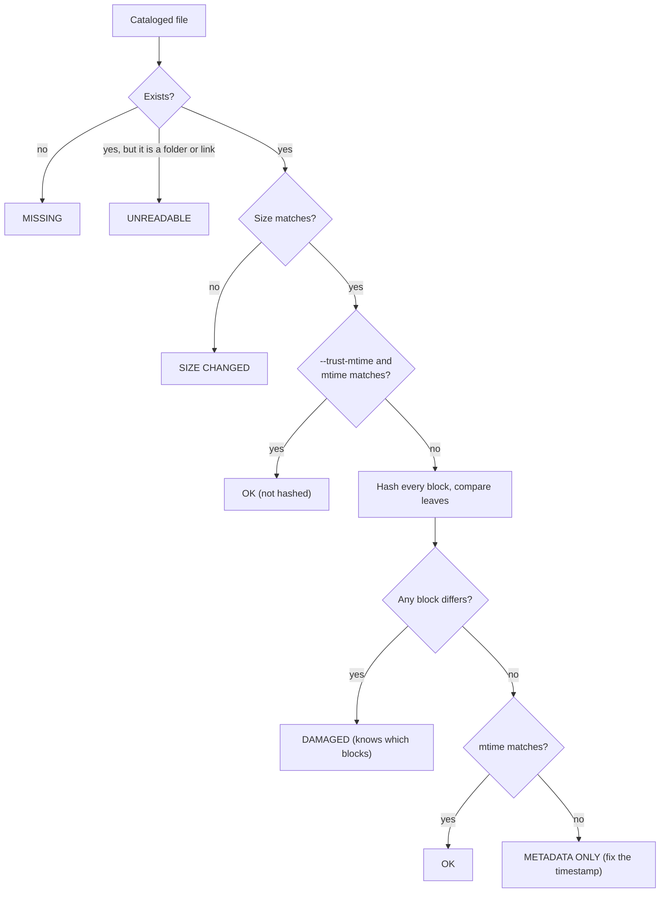
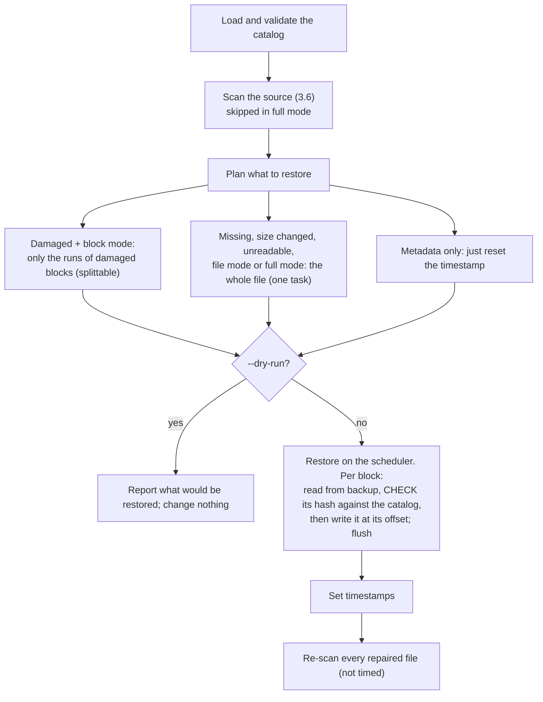

# 3. How IPBRS works

A walk through the engine: the task model, the planner, the scheduler, a backup, a recovery, the safety features, and every source file.

[Back to the guide](README.md) · Previous: [2. The project story](2-the-project.md) · Next: [4. Experiments and results](4-experiments-and-results.md)

---

## 3.1 The big picture



The central design choice is that **the scheduler knows nothing about files**. It receives a list of tasks (each with an estimated cost) and a function to run for each task. Backup, verification, damage scanning and recovery are just different functions, so all of them get the same load balancing for free.

## 3.2 Tasks, ranges and the cost model

A **range** is "blocks *i* to *j* of file *f*". The planner turns ranges into **tasks**:

```text
Task { file, first_block, block_count, whole_file, cost }
cost = 64 KiB (fixed per-task overhead: opening files, metadata) + bytes in the task
```

The fixed 64 KiB term matters: for a 10 KiB file, opening and creating files costs more than reading it, and without the term the scheduler would treat 1,000 tiny files as almost free. Costs are always at least 1, because work stealing uses "remaining cost > 0" to know that work is left.

## 3.3 The planner and the adaptive split rule

`plan_tasks` (in `src/workload.cpp`) decides which files to split:

```text
if split mode is "adaptive" and threads > 1:
    threshold        = max(1 block, total_cost / (threads × split_factor))      split_factor = 8
    blocks_per_piece = threshold in blocks, rounded UP to a multiple of align    (backup: 16-block segments)
    any range with bytes > threshold (and more than 1 block) and that is splittable
        -> pieces of blocks_per_piece, cut at absolute multiples of blocks_per_piece
otherwise: one task per range
```

### Worked example: the `huge` workload at 16 threads

- Data: 4,000 small files + 4 × 400 MiB = 1,647 MiB. Fixed costs: 4,004 × 64 KiB ≈ 250 MiB. **Total cost ≈ 1,897 MiB.**
- threshold = 1,897 ÷ (16 × 8) ≈ 14.8 MiB, which is 14 blocks.
- **Backup** rounds up to whole 16-block segments, so pieces are 16 MiB, and each 400 MiB file becomes 25 pieces: 4,000 + 4 × 25 = **4,100 tasks**. This is exactly what the engine reported in our runs (`tasks=4100`); at 8 threads the same arithmetic gives 32 MiB pieces and 4,052 tasks, also as measured.
- **Verify / scan** has no segment alignment, so pieces are 14 MiB: 29 per file, 4,116 tasks (also as measured).
- Small files are far below the threshold and are never split.



**When splitting is switched off:** with `--split none` (the "file-level" baseline), at 1 thread, for ranges marked unsplittable (whole-file restores, see 3.7), and automatically whenever no file exceeds the threshold.

## 3.4 The scheduler

`run_tasks(tasks, config, work)` in `src/scheduler.cpp` runs every task exactly once with one of four policies:

| Policy | How tasks are handed out | Balances at runtime? | Uses costs? |
|---|---|---|---|
| `seq` | One thread, in order | No | No |
| `static` | LPT partition; each worker runs only its own list | No | Yes |
| `dynamic` | Shared atomic counter; each free worker takes the next `--chunk` tasks (default 1) | Yes | No |
| `steal` | LPT partition into per-worker queues; idle workers steal | Yes | Yes |

**IPBRS** = `steal` + `--split adaptive` (the default). The file-level baseline is `steal` + `--split none`.

### Work stealing, step by step



Details that make it correct:

- Each queue has its own **mutex**, so the owner and a thief never take the same task.
- Each queue also has an **atomic remaining-cost counter**, updated under the lock, so thieves can choose a victim without locking every queue.
- A task that is running can never be stolen, which is exactly why big tasks must be split *before* scheduling.
- Every task runs inside `try`/`catch`; an exception marks it failed (and records the message) instead of crashing the program.

### Statistics recorded per run

| Statistic | Definition |
|---|---|
| `wall_ns` | Time from start to the last worker finishing |
| `busy_ns` (per worker) | Time spent inside tasks |
| `claim_ns` (per worker) | Time spent getting work (own queue or stealing) |
| `finish_ns` (per worker) | When the worker ran out of work |
| load imbalance | (max busy − mean busy) ÷ mean busy |
| idle fraction | 1 − Σ busy ÷ (workers × wall) |
| overhead fraction | (planning + Σ claim) ÷ (workers × wall) |
| finish spread | (last finish − first finish) ÷ wall |
| steals, tasks stolen, cost stolen | How much work moved between workers |

## 3.5 A backup, step by step

Command: `ipbrs backup --source DIR --backup NEW_DIR [--threads N] [--sched steal] [--split adaptive]`



**Backup folder layout:**

```text
backup/
  catalog.ipbrs              the index (written last)
  files/                     files of up to 16 blocks, stored whole
    d0000/f0000001.dat
  segments/                  bigger files, as 16-block (16 MiB) segment objects
    big/b000.dat/000000      blocks 0-15
    big/b000.dat/000001      blocks 16-31
    ...
```

**Why segments:** if several threads write different pieces into *one* backup file, NTFS serialises them and splitting made backup slower. With one segment object per piece, no two threads ever write the same file. Pieces are aligned to segment boundaries so that one task always owns whole segments.

**The catalog format** (`catalog.ipbrs`, plain text; an illustrative excerpt, hashes shortened):

```text
IPBRS-CATALOG 1
block_size 1048576
segment_blocks 16
files 4004
F 419430400 134049829520000000 400 4f1c...e9 big/b000.dat      <- size, mtime, blocks, root, path
1a2b...7c 9d8e...01 ...                                         <- 400 leaf hashes on one line
F 11532 134049829450000000 1 77ab...0d d0000/f0000000.dat
...
```

## 3.6 Damage detection: the scan

Both `verify` (checks the backup) and `recover` (checks the source) use the same two-phase scan:

1. **Metadata phase** (parallel loop): one `GetFileAttributesExW` call per file gives existence, type, size and modification time.
2. **Hash phase** (the scheduler, with splitting): hash every block of every file whose size matches, and compare each leaf with the catalog.



`--trust-mtime` is much faster but blind to silent corruption: a flipped byte with the old timestamp keeps the size and mtime, so the file is never hashed. In the experiments it found 75% of the damage and missed every silently corrupted file. IPBRS therefore hashes by default.

## 3.7 A recovery, step by step

Command: `ipbrs recover --source DIR --backup BACKUP [--mode block|file|full] [--dry-run]`



Key properties:

- **A damaged backup copy is never applied.** Every block read from the backup is hashed and compared with the catalog *before* it is written. If it does not match, the task fails, the file is left as it was, and the failure is reported.
- **Why whole-file restores are not split:** the pieces would all write the same target file, which NTFS serialises. Measured: full recovery took 14.9 s split against 9.8 s unsplit; after the fix both took 6.0 s. Scanning and in-place block repairs still split.
- **Block vs file mode:** for a 512 MiB file with one damaged block, block mode rewrites 1 MiB, file mode rewrites 512 MiB.

## 3.8 Safety and correctness features

| Feature | Where | What it prevents |
|---|---|---|
| Source and backup must not overlap; backup folder must be empty | `run_backup` | Backing up into itself; mixing two backups |
| Catalog written last, atomically (temp, flush, rename) | `save_catalog` | A half-written backup looking complete |
| Not committed if any file fails | `run_backup` | Silent partial backups |
| Source re-checked after copying (size, mtime, read past end) | `run_backup` | Recording a file that changed while it was copied |
| Durable writes (`FlushFileBuffers`) | backup and restore | Losing "finished" data in a power cut |
| Catalog validation: header, geometry, counts, root vs leaves, no duplicates, no file-as-folder, no trailing data | `load_catalog` | Restoring from a corrupt or tampered index |
| Safe relative paths only (no `..`, drive letters, absolute paths) | `is_safe_relative_path` | A catalog writing outside the target folder |
| Verify each backup block before writing it | `run_recover` | Spreading a corrupted backup into the source |
| Extra files in the source are ignored, never deleted | `run_recover` | Losing files created after the backup |
| Exceptions caught per task | `run_tasks` | One bad file crashing the whole run |

## 3.9 Code tour

| File | Responsibility | Key functions and types |
|---|---|---|
| `src/main.cpp` | Command-line parsing and the five commands; exit codes 0 (ok), 2 (verification failed or backup not committed), 1 (error) | `run`, `Args`, `run_config` |
| `src/engine.cpp` | Backup, verify and recovery; the shared scan | `run_backup`, `run_verify`, `run_recover`, `scan_tree`, `BlockSource` |
| `src/scheduler.cpp` | The four policies, LPT, work stealing, statistics | `run_tasks`, `lpt_partition`, `parallel_region`, `SchedulerStats` |
| `src/scheduler.hpp` | Task and statistics types; `parallel_for` helper for simple phases | `Task`, `WorkerStats`, `parallel_for` |
| `src/workload.cpp` | Parallel discovery; the planner and split rule | `discover_files`, `plan_tasks` |
| `src/catalog.cpp` | Catalog format, validation, storage layout | `save_catalog`, `load_catalog`, `stored_path`, `is_safe_relative_path` |
| `src/merkle.cpp` | Leaf hash, Merkle root, block geometry | `leaf_hash`, `merkle_root`, `block_count`, `block_length` |
| `src/sha256.cpp` | SHA-256 (FIPS 180-4), hex conversion | `Sha256`, `sha256`, `to_hex`, `parse_hex` |
| `src/fileio.cpp` | Positioned reads and writes, resize, flush, timestamps, one-call metadata (Windows and POSIX) | `File`, `stat_path` |
| `src/dataset.cpp` | Synthetic workload generator and the four damage types | `generate_dataset`, `inject_damage` |
| `src/util.cpp` | Timer, deterministic random numbers (SplitMix64), JSON writer | `now_ns`, `Rng`, `Json` |

**Tests** (`tests/`, 38 in total; `build.bat test`):

| File | Tests | Covers |
|---|---|---|
| `test_util.cpp` | 3 | JSON writer, deterministic RNG |
| `test_sha256.cpp` | 3 | NIST vectors, streaming boundaries, hex parsing |
| `test_merkle_catalog.cpp` | 8 | Tree shape, domain separation, catalog round trip, tampering, unsafe paths, layout |
| `test_catalog_robustness.cpp` | 4 | Corrupt headers, truncation, bad counts, duplicates |
| `test_scheduler.cpp` | 6 | Exactly-once at 1–16 threads, failures, stealing, statistics, LPT bound |
| `test_planner.cpp` | 6 | Split rule, tiling, alignment, unsplittable ranges, edge cases |
| `test_end_to_end.cpp` | 8 | Real backups and recoveries on disk, compared byte for byte |

## 3.10 Command reference

```text
ipbrs gen      --out DIR [--files N] [--profile low|medium|high] [--seed S] [--dup R]
               [--big-files K] [--big-mib M] [--per-dir N]
ipbrs damage   --target DIR [--ratio R] [--types missing,modified,corrupted,truncated] [--seed S]
ipbrs backup   --source DIR --backup DIR [--block-kib N] [--no-sync]
ipbrs verify   --backup DIR
ipbrs recover  --source DIR --backup DIR [--mode block|file|full] [--trust-mtime]
               [--dry-run] [--no-verify] [--no-sync]

scheduling (backup, verify, recover):
  --sched seq|static|dynamic|steal     default steal
  --split none|adaptive                default adaptive (steal + adaptive = IPBRS)
  --threads N                          default: all logical processors
  --chunk N                            tasks per claim for dynamic (default 1)
  --split-factor K                     pieces per thread target (default 8)
  --task-cost-kib N                    fixed per-task cost (default 64)
  --json FILE                          also append the result record to FILE
```

Every command prints one JSON line with all the details: counts, phase times, the plan and per-worker statistics. The benchmark scripts store these records unchanged.
