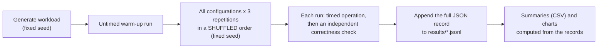

# 4. Experiments and results

How every number was produced, how to read each chart, why the results look the way they do, and how to defend them. The full report is [RESULTS.md](../../RESULTS.md); this chapter explains it.

[Back to the guide](README.md) · Previous: [3. How IPBRS works](3-how-it-works.md) · Next: [5. Demo and presenting](5-demo-and-presenting.md)

---

## 4.1 The setup

| | |
|---|---|
| CPU | AMD Ryzen 7 7435HS: **8 cores, 16 hardware threads** |
| Memory | 16 GB |
| Disk | WD SN740 512 GB NVMe SSD, about 90% full during the runs |
| OS and build | Windows 11, MSVC 19.44, OpenMP 2.0, Release build |

**Three workloads**, generated with a fixed seed (`bench/workloads.py`), 5% of files duplicated:

| Name | Contents | Size | Purpose |
|---|---|---|---|
| `small` | 20,000 files of 8–16 KiB | 234 MiB | Per-file overhead dominates |
| `mixed` | 3,000 files, 256 B – 4 MiB (log-uniform) | 1,300 MiB | Varied sizes, no file dominates |
| `huge` | 4,000 small + 4 × 400 MiB | 1,647 MiB | A few files dominate: **the case IPBRS targets** |

**Configurations compared:** sequential (1 thread, the baseline), static, dynamic and steal, each with splitting off (file-level) and on (IPBRS), at 2, 4, 8 and 16 threads.

## 4.2 The method, and why it is fair

- **Same data for everyone:** every configuration runs on the identical workload. Recovery runs re-apply the **same seeded damage** before every run, so every configuration repairs exactly the same files.
- **Shuffled order:** if the laptop gets warmer or the disk slower over time, that affects all configurations equally instead of whichever ran last.
- **Correctness checked separately, outside the timing:** after each backup, `verify` re-hashes it; each recovery re-hashes what it repaired; each detection scan is compared with the known damage. A fast but wrong run would be flagged. None was.
- **Resumable and raw:** every run's full output is stored, so every summary and chart can be recomputed (`python bench/plot.py`).

### Why "best of 3" and not the average

Write-heavy runs on this laptop varied far more than the engine's work does. Identical single-thread backups of `small` took **36–43 s in 11 of 21 runs and 76–172 s in the other 10**; identical runs of `huge` ranged from 14 to 48 s. A tight fast cluster plus slow outliers is the signature of outside interference that comes and goes: a nearly full consumer SSD whose fast write cache runs out, plus Windows Defender scanning new files. The engine does the same work in every run.

The minimum of several runs is the standard way to measure what a system can do without outside interference. Two checks keep this honest:

1. **Read-only experiments barely change** with the choice: verify and detection runs varied by about ±0.01–0.1 s, so mean and best agree.
2. **All raw runs are in the repository**, including the slow ones, so anyone can recompute means.

## 4.3 Result 1: verify scaling (the cleanest experiment)

Verify re-hashes every block of a backup. It only reads, so it isolates the CPU-bound work that splitting targets.

**How to read it:** one panel per workload; x-axis threads (1 to 16); y-axis speedup over sequential; the dashed line is perfect linear speedup. Blue circles: file-level stealing. Orange squares: IPBRS.

| `huge`, best of 3 | 1 | 2 | 4 | 8 | 16 threads |
|---|---|---|---|---|---|
| File-level | 5.98 s | 3.07 s | 1.69 s | 1.62 s | 1.65 s (**3.6×**) |
| IPBRS | 5.98 s | 3.04 s | 1.68 s | 1.06 s | 0.87 s (**6.9×**) |

**Why file-level stops at 4 threads.** With 4 big files, the 4 workers that get them each hash 400 MiB, which takes about 1.5 s at roughly 275 MiB/s. Up to 4 threads everyone is busy. With 8 or 16 threads the extra workers finish the small files almost immediately and then have nothing to steal, because a task that is running cannot be split. The run can never be shorter than one big file. Static and dynamic scheduling stop at the same time (1.62–1.70 s), which proves that the limit is the **granularity**, not the policy.

**Why IPBRS keeps going.** Each big file becomes about 29 pieces of 14 MiB, so 16 workers share them.

**Why not 16×.** The laptop has **8 physical cores**; 16 threads are 2 per core and share its execution units, so about 8× is the realistic ceiling for hashing. `mixed` reaches 7.7×, close to that ceiling. `huge` reaches 6.9×; the gap is most likely the 4,000 small files and per-task overhead (opening files for each piece).

**Why `small` and `mixed` look identical for both.** No file is above the split threshold, so IPBRS does exactly what file-level does. This is important: **splitting costs nothing when it is not needed.** (`small` reaches only 4.6× because per-file work such as opening files and reading metadata dominates; we did not profile it further.)

## 4.4 Why: the load-balance picture

This is the most convincing figure, so learn to explain it:

- **Left (file-level):** each bar is one worker's busy time. 4 workers are busy for 1.58 s (the 4 big files); 12 finish their share of small files in under 0.1 s and then wait. The run ends at 1.58 s. **Idle time 72%, load imbalance 2.54.**
- **Right (IPBRS):** all 16 workers are busy for 0.82–0.84 s and the run ends at 0.84 s. **Idle time 2%, imbalance 0.02.**

Up to 4 threads both are equal (4 big files keep 4 workers busy). File-level idle time climbs to 46% at 8 threads and 72% at 16; IPBRS stays near zero.

## 4.5 Result 2: damage detection and the `--trust-mtime` trade-off

Detection is a dry-run recovery on a tree where 5% of the files were damaged (all four types).

- `huge` at 16 threads: **IPBRS 0.78 s (7.4×) against 1.59 s (3.6×) file-level.** Same shape as verify.
- Full hashing found **100%** of damaged files in every run.
- `--trust-mtime` (skip hashing when size and mtime match) was 2–39× faster depending on workload and threads, but found only **75%**: it missed every silently corrupted file (one byte flipped, timestamp kept). This is why hashing is the default.

## 4.6 Result 3: selective recovery

| 16 threads, best of 3 | Block (IPBRS) | Block (file-level) | Full recovery | Data written back (block) |
|---|---|---|---|---|
| `huge`, 5% damaged | **1.01 s** | 1.89 s | 5.74 s | **0.15%** (2.4 of 1,647 MiB) |
| `huge`, 20% damaged | **3.20 s** | 4.36 s | 5.81 s | 25% (file mode: 49%) |
| `mixed`, 5% damaged | 0.82 s | 0.90 s | 3.19 s | 3.6% |

**How to explain it:**

1. **Recovery = scan + write back.** The scan (hashing the whole source) dominates the time, and the scan is exactly where splitting helps: 1.9× over file-level on `huge`.
2. **Selective vs full:** 5.7× faster at 5% damage, shrinking to 1.8× at 20% damage, because more large files are deleted or truncated and must be rewritten whole.
3. **Block vs file mode take about the same time** because both pay for the same scan. Block mode's gain is **data written**: at 20% damage it writes half of what file mode writes. That matters for SSD wear and for slow or remote storage.
4. **Why imbalance stays high at 20% on `huge`:** that run is dominated by rewriting whole big files (deleted or truncated), which are deliberately not split because the pieces would all write one file.

## 4.7 Result 4: durable backup

| 16 threads, best of 3 | Sequential | File-level | IPBRS |
|---|---|---|---|
| `small` | 40.1 s | 2.0× | 1.9× |
| `mixed` | 13.5 s | 4.3× | 4.1× |
| `huge` | 17.7 s | 2.8× | **3.3×** (imbalance 0.06 vs 0.76) |

**How to explain it:** backup has to read, hash, write **and flush** every byte, so it is limited by the SSD, not the CPU. Threads still help, by overlapping the per-file flush delay (`small`) and keeping the drive's queue full (`mixed`). IPBRS helps where big files dominate (`huge`), but the disk caps the gain. Where all policies are within a few tenths, call it a tie; the noise is that large.

## 4.8 Defending the numbers

| Claim | Evidence | How it was computed |
|---|---|---|
| IPBRS verify 6.9× at 16 threads | `results/scan_summary.csv`, experiment `verify`, workload `huge` | best sequential (5.98 s) ÷ best IPBRS at 16 threads (0.87 s) |
| File-level stuck at 3.6× | same file, split `none` | 5.98 ÷ 1.65 |
| 72% → 2% idle | `results/scan.jsonl`, the per-worker `busy_ns` of one run | 1 − Σ busy ÷ (16 × wall) |
| 0.15% rewritten, 5.7× vs full | `results/recovery_summary.csv`, `huge`, ratio 0.05 | restored ÷ total bytes; full time ÷ block time |
| 100% vs 75% detection | `results/scan_summary.csv`, `detected_fraction` | files reported ÷ files damaged |
| All runs correct | `verified` in every record of `results/*.jsonl` | independent verify after each run |

**The three strongest defences:**

1. **"Is the comparison fair?"** Same data, same seed, same machine, shuffled order, same scheduler code. The only difference between file-level and IPBRS is one flag, `--split none` vs `--split adaptive`.
2. **"Is it only best-of-3 magic?"** The headline results are read-only runs, where mean and best agree within about 0.1 s. Best-of-3 matters only for the write-heavy backup runs, and their raw data is published.
3. **"Did you just break correctness to be fast?"** Every one of the 873 runs was verified, and the demo ends with Windows' own `Get-FileHash`.

## 4.9 What would change on other hardware

| Change | Expected effect |
|---|---|
| More physical cores | Higher verify and detection speedups; the file-level plateau stays at the number of big files |
| Faster or emptier SSD | Better backup speedup (the write ceiling moves up) |
| Hard disk or network storage | Backup and restore even more I/O-bound; block-level recovery's smaller writes matter more |
| Hardware SHA-256 (SHA-NI) | Hashing much cheaper, so everything shifts toward I/O-bound |
| Workload without big files | IPBRS equals file-level (no splitting), as measured on `small` and `mixed` |
