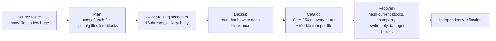

# IPBRS study guide

This guide explains the whole project from zero, so that you can understand it, explain it to an interviewer or instructor, run the demo, and defend every result. Nothing is assumed: chapter 1 starts with "what is a hash?" and "what is a thread?".

Diagrams are written in Mermaid, which GitHub draws automatically. In VS Code, open a file and press `Ctrl+Shift+V` for the preview; if the diagrams show as code, install the extension "Markdown Preview Mermaid Support".

## Reading plan

| Chapter | What you will be able to do afterwards | Time |
|---|---|---|
| [1. Foundations](1-foundations.md) | Explain hashing, Merkle trees, threads, OpenMP, speedup, Amdahl's law, scheduling and work stealing | 60 min |
| [2. The project story](2-the-project.md) | Tell the story: the brief, what existed, what was wrong, what we built and why, the tech stack | 25 min |
| [3. How IPBRS works](3-how-it-works.md) | Walk through a backup and a recovery step by step, and explain every source file | 60 min |
| [4. Experiments and results](4-experiments-and-results.md) | Explain how every number was measured, read every chart, and defend the results | 45 min |
| [5. Demo and presenting](5-demo-and-presenting.md) | Run the live demo, present the slides, and give 30-second, 2-minute and 5-minute pitches | 30 min |
| [6. Interview questions](6-interview-qa.md) | Answer about 50 likely questions, including the hard ones | 60 min |

**Before an interview:** reread section 5.3 (the pitches), the [one-page cheat sheet](#one-page-cheat-sheet) below, and chapter 6.

## The project in one picture

## One-page cheat sheet

**What it is.** IPBRS (Intelligent Parallel Backup and Recovery System) is a C++17 / OpenMP engine for backing up a folder and repairing it later. It runs on one multi-core machine.

**The problem.** Parallel backup tools give each *file* to one thread, because SHA-256 must read a file from start to end. When a few files are much bigger than the rest, a few threads do almost all the work and the others wait. We measured **72% of worker time idle** at 16 threads.

**The idea.** Hash files as **Merkle trees of 1 MiB blocks**. Then any block can be hashed or copied by any thread. The scheduler **splits large files into block-range tasks** (only files bigger than total work ÷ (threads × 8)) and balances them with **cost-aware work stealing**. Recovery uses the same block hashes to **rewrite only damaged blocks**.

**Key results** (AMD Ryzen 7 7435HS, 8 cores / 16 threads, best of 3):

| | File-level | IPBRS |
|---|---|---|
| Verify, huge workload, 16 threads | 3.6× (stuck from 4 threads) | **6.9×** |
| Damage detection, huge, 16 threads | 3.6× | **7.4×** |
| Worker idle time, 16 threads | 72% | **2%** |
| Block recovery, huge, 5% damaged | 1.89 s | **1.01 s** (0.15% of data rewritten, 5.7× faster than full recovery) |
| Durable backup, 16 threads | 2–4×, limited by the SSD | IPBRS best on huge: 3.3× vs 2.8× |

**Correctness.** 38 automated tests, 873 benchmark runs each independently verified, 100% of damage found (the size-and-timestamp shortcut finds 75%), and a damaged backup block is never written back.

**Honest limits.** No gain when no file dominates (but also no cost); backup is limited by disk write speed; one laptop, three repetitions.

**Stack.** C++17, OpenMP 2.0, MSVC 19.44 (Visual Studio 2022 Build Tools), CMake + Ninja, Windows file APIs; Python 3 + matplotlib for benchmarks and charts.

**Repository.** `github.com/sadm888/Parallel-Backup-and-Recovery-System`, branch `harshith-dev`. Results in [RESULTS.md](../../RESULTS.md); slides at the deck link.
